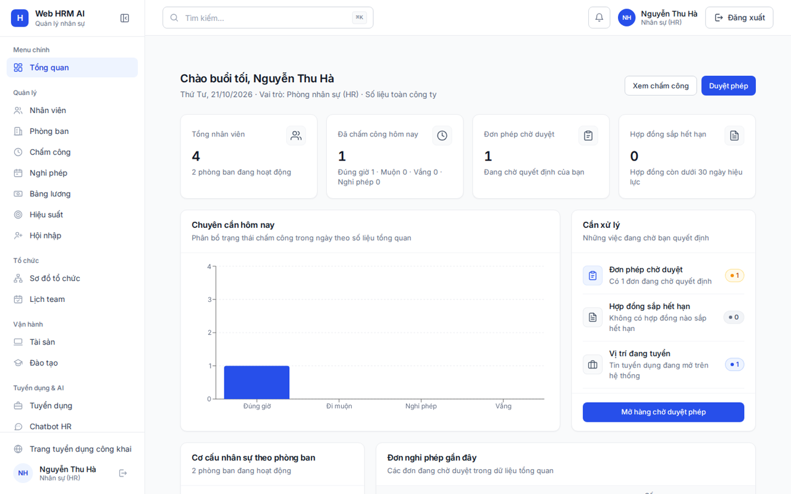
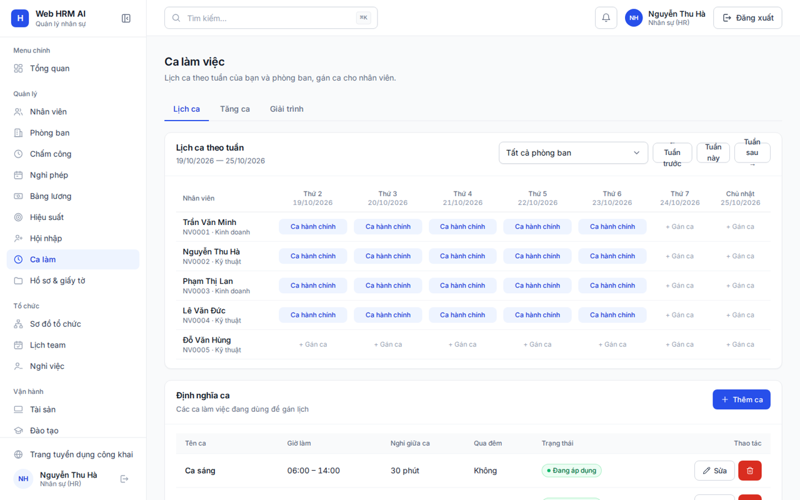
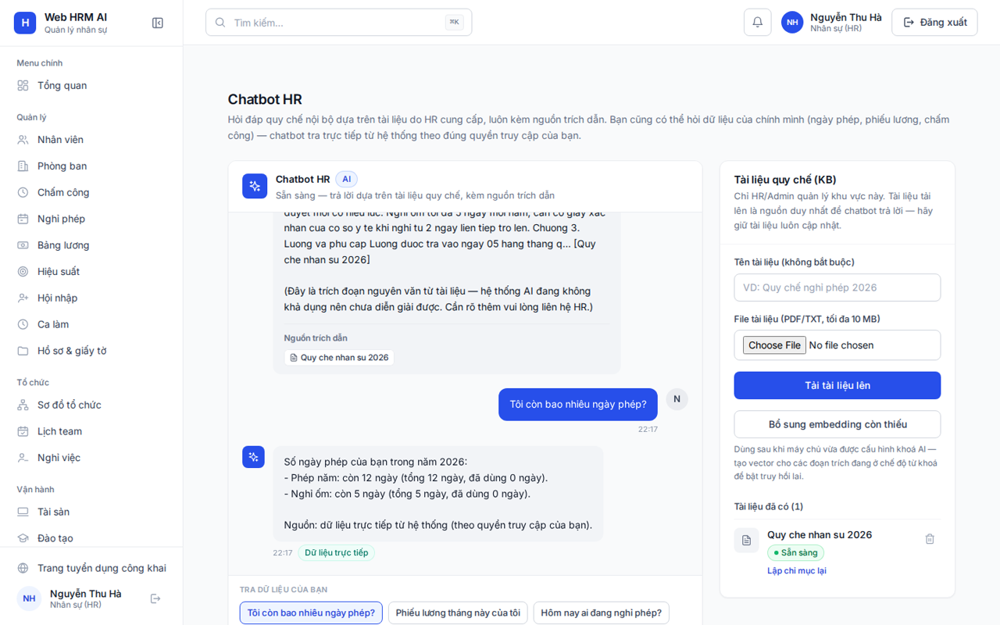

<p align="center">
  
</p>

<h1 align="center">Web HRM AI</h1>

<p align="center">
  Hệ thống quản lý nhân sự (HRM) trên nền web, tích hợp AI sàng lọc CV, chatbot hỏi đáp
  quy chế bằng RAG và chatbot tra cứu dữ liệu nhân sự trực tiếp theo phân quyền.
</p>

<p align="center">
  
  
  
  
</p>

<p align="center">
  <strong>Demo trực tuyến:</strong>
  <a href="https://hrm-ai-gray.vercel.app">hrm-ai-gray.vercel.app</a>
  · API: <a href="https://hrm-ai-api.onrender.com/api/v1/health">hrm-ai-api.onrender.com</a>
  (bản free nên lần mở đầu sau thời gian dài không dùng có thể cần chờ khoảng 1 phút để máy chủ "thức dậy")
</p>

---

## Tài khoản demo

| Vai trò | Email | Mật khẩu | Quyền tiêu biểu |
|---|---|---|---|
| Admin | `admin@hrm.local` | `Admin@123` | Toàn quyền, quản trị hệ thống |
| HR | `hr@hrm.local` | `Hr@12345` | Quản lý nhân sự, duyệt cấp cuối, cấp giấy xác nhận |
| Manager | `manager@hrm.local` | `Manager@123` | Quản lý phòng ban của mình, duyệt cấp 1 |
| Employee | `employee@hrm.local` | `Employee@123` | Tự phục vụ: chấm công, xin phép, xem phiếu lương |

Ứng viên bên ngoài có trang tuyển dụng công khai tại `/jobs` — nộp CV không cần tài khoản.

## Tính năng

### Quản lý nhân sự cốt lõi
- **Nhân viên & phòng ban**: hồ sơ nhân viên, hợp đồng, sơ đồ tổ chức, lịch team.
- **Chấm công**: check-in/check-out, tổng hợp tháng theo giờ Việt Nam.
- **Nghỉ phép**: số dư phép, gửi đơn và **duyệt 2 cấp** (quản lý trực tiếp → HR).
- **Bảng lương**: kỳ lương, tính lương theo công thức cấu hình được, khoá kỳ và phát hành phiếu lương cá nhân.
- **Tuyển dụng**: đăng tin, ứng viên nộp CV tại trang công khai, HR quản lý pipeline.

### Hiệu suất & phát triển
- **KPI/OKR**: chu kỳ đánh giá, mục tiêu (Objective), kết quả then chốt (Key Result), check-in tiến độ, đánh giá cuối kỳ, thư viện mục tiêu mẫu.
- **Hội nhập (Onboarding)**: mẫu checklist theo phòng ban, tự sinh kế hoạch khi tạo nhân viên mới, theo dõi tiến độ.
- **Đào tạo nội bộ**: khoá học, gán học viên, theo dõi % hoàn thành.
- **Tài sản công ty**: cấp phát/thu hồi laptop, thiết bị… kèm thông báo tự động.
- **Báo cáo nhân sự**: biểu đồ tổng quan + xuất CSV (UTF-8, mở đúng tiếng Việt trong Excel).

### Nghiệp vụ HR hiện đại
- **Ca làm việc**: định nghĩa ca, gán ca theo tuần cho từng phòng ban; đơn **tăng ca** và đơn **giải trình chấm công** duyệt 2 cấp — duyệt xong tự cập nhật bản ghi chấm công.
- **Hồ sơ điện tử**: kho tài liệu của từng nhân viên (hợp đồng, giấy tờ tuỳ thân…), cảnh báo sắp/hết hạn; nhân viên tự xin **giấy xác nhận lương / xác nhận công tác**, HR duyệt và cấp file.
- **Nghỉ việc (Offboarding)**: quy trình bàn giao có checklist tự sinh (gồm một mục riêng cho từng tài sản đang cấp phát), hoàn tất xong hệ thống tự chuyển trạng thái nhân viên và khoá tài khoản.

### Gắn kết nhân viên
- **Kudos**: tặng lời khen kèm huy hiệu cho đồng nghiệp, tường vinh danh, bảng xếp hạng tháng, tiện ích vinh danh mới nhất trên Dashboard.
- **Khảo sát xung & eNPS**: HR tạo khảo sát (câu eNPS 0–10, thang 1–5, trắc nghiệm, tự luận); đáp án **ẩn danh ở mức dữ liệu** — hệ thống lưu riêng phần "đã tham gia" chỉ để chống trả lời trùng, kết quả tổng hợp không gắn với danh tính.
- **Cột mốc**: sinh nhật và kỷ niệm ngày vào làm của toàn công ty theo tháng.
- **Bảng tin nội bộ**: dòng bài viết kiểu mạng xã hội nội bộ — đăng bài, thả tim, bình luận, ghim bài quan trọng; cột hoạt động tổng hợp sự kiện mới nhất toàn công ty và hiển thị ngay trên Dashboard.
- **Hành trình của tôi**: trang cá nhân nhìn lại chặng đường làm việc — bản đồ nhiệt chấm công cả năm kiểu GitHub, chuỗi ngày đi làm đúng giờ, điểm thưởng và huy hiệu của chính mình.
- **Chatbot hành động**: chatbot không chỉ trả lời mà còn soạn sẵn đơn nghỉ phép / quyết định duyệt đơn ngay trong khung chat — chỉ thực thi khi người dùng bấm xác nhận, quyền được kiểm tra lại ở server.
- **Phỏng vấn thử với AI**: ứng viên chọn vị trí đang tuyển, AI đặt 5 câu hỏi theo đúng mô tả công việc, chấm điểm và nhận xét từng câu, tổng kết điểm mạnh / cần cải thiện cuối buổi.
- **Màn hình sảnh (chế độ TV)**: trang toàn màn hình tự luân chuyển để treo ở sảnh — vinh danh & bảng xếp hạng, sinh nhật và cột mốc, thông báo mới, nhịp hoạt động của công ty.
- **Bản đồ năng lực**: ma trận kỹ năng toàn công ty (phòng ban × kỹ năng), hồ sơ năng lực từng nhân viên kèm biểu đồ radar, gợi ý khoá học lấp khoảng trống kỹ năng.
- **AI kiểm tra CV công khai**: ngay trên trang tuyển dụng, ứng viên dán hoặc tải CV lên để nhận điểm phù hợp với vị trí và góp ý cải thiện trong vài giây — CV không được lưu lại.

### Game hoá & phúc lợi
- **Điểm thưởng**: tự tích lũy từ hoạt động thật — nhận kudos (+10), hoàn thành khoá học (+50), mỗi ngày đi làm đúng giờ (+2); sổ điểm minh bạch, chống cộng trùng.
- **Cửa hàng quà**: đổi điểm lấy quà (voucher, áo thun, thiết bị, thêm ngày phép…); HR quản lý danh mục và duyệt yêu cầu, điểm chỉ trừ khi duyệt thành công.
- **Huy hiệu thành tích**: các cột mốc như "Đúng giờ 7 ngày liên tiếp", "Chiến binh học tập", "Ngôi sao gắn kết" tự sáng lên từ dữ liệu thật, kèm bảng xếp hạng điểm toàn công ty.

### Trí tuệ nhân tạo
- **Sàng lọc CV**: đọc PDF, trích xuất kỹ năng/kinh nghiệm, chấm điểm phù hợp với mô tả công việc và xếp hạng ứng viên. AI chỉ gợi ý — quyết định cuối luôn thuộc về HR.
- **Chatbot quy chế (RAG)**: trả lời từ tài liệu nội bộ do HR tải lên, luôn kèm trích dẫn nguồn. Truy hồi lai (vector embedding + từ khoá, hợp nhất 0.7/0.3) và xếp hạng lại bằng LLM để chọn đoạn liên quan nhất.
- **Chatbot tra dữ liệu thật**: hỏi bằng tiếng Việt tự nhiên — "Tôi còn bao nhiêu ngày phép?", "Phiếu lương tháng này của tôi", "Hôm nay ai đang nghỉ phép?" — chatbot tra trực tiếp dữ liệu hệ thống **theo đúng quyền của người hỏi** (nhân viên chỉ thấy của mình, quản lý thấy phòng mình, HR/Admin toàn công ty) và ghi rõ nguồn dữ liệu. Không có khoá AI vẫn chạy được nhờ bộ nhận diện ý định tất định.
- **Dự báo nguy cơ nghỉ việc**: chấm điểm theo luật minh bạch (đi muộn, vắng không phép, biến động nghỉ phép, điểm hiệu suất, thâm niên — cửa sổ 60 ngày), liệt kê rõ từng yếu tố cộng điểm để HR chủ động chăm sóc nhân viên; điểm chỉ mang tính tham khảo.

Chưa cấu hình `AI_API_KEY`: các tính năng AI dùng LLM trả về thông báo rõ ràng, toàn bộ nghiệp vụ HRM còn lại vẫn hoạt động bình thường.

## Ảnh chụp màn hình

| Dashboard tổng quan | Ca làm việc theo tuần |
|---|---|
|  |  |

Chatbot trả lời số ngày phép thật của người hỏi, kèm nhãn "Dữ liệu trực tiếp":



## Kiến trúc & công nghệ

| Tầng | Công nghệ |
|---|---|
| Frontend | React JS + Vite, React Router, TanStack Query, Tailwind CSS, Recharts |
| Backend | Flask (blueprint theo module), Flask-JWT-Extended, SQLAlchemy, Marshmallow |
| Dữ liệu | PostgreSQL (production) / SQLite (chạy local nhanh) |
| AI | API tương thích OpenAI cho chat + embedding; RAG lai + rerank; bộ công cụ tra dữ liệu có kiểm soát phân quyền |
| Triển khai | Docker Compose (local), Vercel (frontend) + Render (backend) + Neon PostgreSQL |

Tài liệu chi tiết trong thư mục `docs/`:

- [Phân tích & kiến trúc hệ thống](docs/architecture.md)
- [Mở rộng v2 — KPI/OKR, Onboarding, Tài sản, Đào tạo, Báo cáo](docs/feature-expansion-v2.md)
- [Mở rộng v3 — Ca làm, Hồ sơ điện tử, Offboarding, Gắn kết, AI dữ liệu thật](docs/feature-expansion-v3.md)
- [Nâng cấp RAG — embedding, truy hồi lai, rerank](docs/rag-upgrade.md)
- [Triển khai production](docs/deployment-golden-combo.md) · [Bảo mật & kế hoạch kiểm thử Strix](docs/security.md)

## Chạy trên máy cá nhân

Yêu cầu tối thiểu: Git, Python 3.10+, Node.js 18+ (hoặc chỉ Docker nếu dùng Compose).

### Cách 1 — Một lệnh duy nhất

**Windows** (PowerShell):

```powershell
irm https://raw.githubusercontent.com/ryanowlops/web-hrm-ai/main/run.ps1 | iex
```

hoặc tải repo về rồi chạy `run.bat`. **macOS / Linux:**

```bash
git clone https://github.com/ryanowlops/web-hrm-ai.git && cd web-hrm-ai && ./run.sh
```

Script tự làm toàn bộ: tải code → cài thư viện backend + frontend → tạo dữ liệu mẫu → chạy Flask (cổng 5000) + React (cổng 5173) → mở trình duyệt tại http://localhost:5173. Dừng bằng `Ctrl+C`; những lần sau chỉ cần chạy lại `run.bat` / `./run.sh` trong thư mục dự án.

### Cách 2 — Docker Compose

```bash
git clone https://github.com/ryanowlops/web-hrm-ai.git && cd web-hrm-ai && docker compose up --build
```

### Cách 3 — Chạy thủ công từng phần

```bash
# Backend — cổng 5000
cd server
python -m venv .venv && source .venv/bin/activate   # Windows: .venv\Scripts\activate
pip install -r requirements.txt
python seed.py        # tạo cơ sở dữ liệu + dữ liệu mẫu (chạy 1 lần, chạy lại vẫn an toàn)
python run.py

# Frontend — cổng 5173, tự chuyển tiếp /api sang backend
cd client
npm install
npm run dev
```

## Bật tính năng AI

Tạo file `server/.env` từ mẫu `.env.example` và điền:

- `AI_API_KEY` — khoá API của nhà cung cấp tương thích OpenAI (ví dụ OpenAI, hoặc Gemini qua đầu mối tương thích của Google AI Studio).
- `AI_MODEL` — model chat (ví dụ `gpt-4o-mini`, `gemini-2.0-flash`).
- `AI_EMBEDDING_MODEL` — model embedding (ví dụ `text-embedding-3-small`, `text-embedding-004`).

Sau khi có khoá, mở trang Chatbot HR → panel "Tài liệu quy chế (KB)" → bấm **Bổ sung embedding còn thiếu** để chuyển các tài liệu đã tải từ chế độ từ khoá sang truy hồi lai.

## Cấu trúc thư mục

```
web-hrm-ai/
├── client/            # Frontend React JS (Vite)
│   ├── public/        # Logo, favicon
│   └── src/
│       ├── app/       # Router + đăng ký trang (nạp lười theo route)
│       ├── features/  # Mỗi nghiệp vụ một thư mục (dashboard, shifts, kudos, ...)
│       ├── components/# UI kit dùng chung + hiệu ứng chuyển động
│       └── layouts/   # Khung ứng dụng (sidebar, thanh trên, tìm kiếm ⌘K)
├── server/            # Backend Flask
│   ├── app/
│   │   ├── blueprints/  # Mỗi module một blueprint (auth, leave, shifts, engagement, ...)
│   │   ├── models/      # Mô hình SQLAlchemy theo miền nghiệp vụ
│   │   └── ai_service/  # Lớp trừu tượng gọi nhà cung cấp AI
│   └── seed.py          # Dữ liệu mẫu (idempotent — chạy lại không trùng)
├── docs/              # Tài liệu phân tích, kiến trúc, triển khai + ảnh minh hoạ
├── run.bat / run.sh / run.ps1   # Khởi động 1 lệnh
└── docker-compose.yml
```

## Lưu ý bảo mật

- Không commit file `.env`, khoá API hay mật khẩu thật — repo chỉ chứa `.env.example` với giá trị mẫu rỗng.
- Mật khẩu tài khoản demo ở trên chỉ dùng cho môi trường trình diễn.
- Phân quyền được kiểm tra ở backend theo vai trò **và** phạm vi dữ liệu (cá nhân / phòng ban / toàn công ty); giao diện chỉ ẩn/hiện theo quyền, không phải nơi thực thi quyền.
- File tải lên ở module Hồ sơ điện tử được kiểm tra định dạng và giới hạn dung lượng; giấy tờ nhân viên chỉ tải xuống được trong đúng phạm vi quyền.

## Giấy phép & mục đích

Dự án học tập (đồ án môn học) — xây dựng nhằm mục đích nghiên cứu và trình diễn kỹ thuật.
