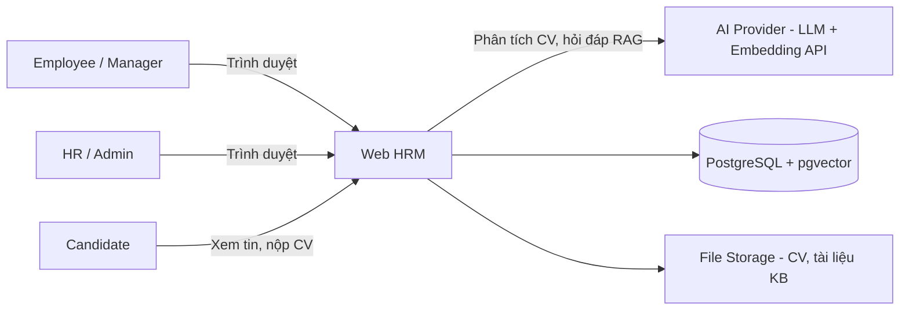
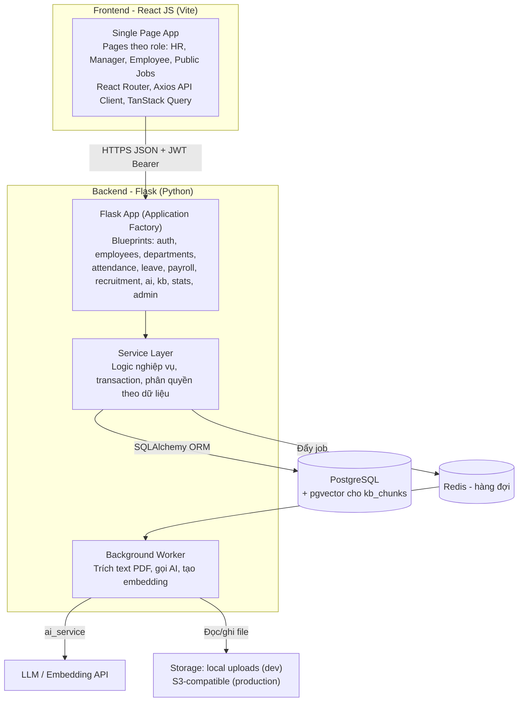
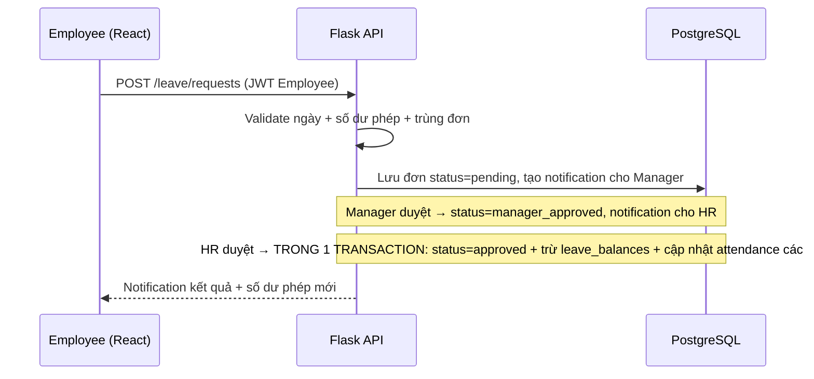
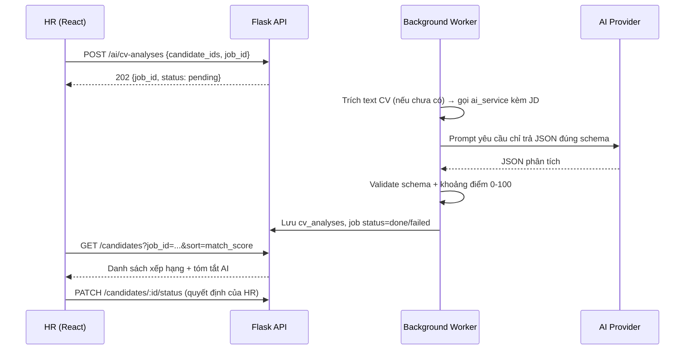

# Phân tích & Kiến trúc hệ thống — Web HRM tích hợp AI

> **Đề tài:** Web quản lý nhân sự (HRM) tích hợp trí tuệ nhân tạo — đồ án / bài tập lớn
> **Tech stack:** Backend **Flask** (Python) · Frontend **React JS** (JavaScript, Vite) · Database **PostgreSQL** (MySQL tương đương)
> **Phiên bản tài liệu:** 1.0 — 21/10/2026
> **Trạng thái:** Tài liệu phân tích — thiết kế để triển khai và viết báo cáo. Chưa có mã nguồn tại thời điểm viết.

Tài liệu gồm 2 phần: **Phần A — Phân tích chi tiết** (bài toán, nghiệp vụ, yêu cầu, dữ liệu, AI) và **Phần B — Kiến trúc** (công nghệ Flask + React JS, module, luồng dữ liệu, API, bảo mật, triển khai).

---

# PHẦN A — PHÂN TÍCH CHI TIẾT

## A1. Bối cảnh và bài toán

Doanh nghiệp vừa và nhỏ (SME, 20–200 nhân viên) thường quản lý nhân sự bằng Excel và giấy tờ, dẫn tới 4 vấn đề lặp lại:

1. **Hồ sơ phân tán:** thông tin nhân viên, hợp đồng nằm ở nhiều file — tìm kiếm chậm, dễ sai lệch phiên bản.
2. **Chấm công và nghỉ phép thủ công:** tổng hợp ngày công cuối tháng tốn thời gian, đơn nghỉ phép duyệt qua chat/giấy dễ thất lạc, không tra cứu lại được.
3. **Tính lương chậm và dễ sai:** phải đối chiếu tay bảng công, phụ cấp, ngày nghỉ không lương cho từng người.
4. **Tuyển dụng quá tải:** mỗi vị trí nhận hàng chục CV, HR phải đọc và lọc thủ công, dễ bỏ sót ứng viên tốt và khó giải thích vì sao loại.

Hệ thống HRM này giải quyết 3 vấn đề đầu bằng số hóa nghiệp vụ lõi, và vấn đề thứ 4 bằng **AI sàng lọc CV** — đồng thời bổ sung **chatbot HR hỏi đáp quy chế nội bộ** để giảm câu hỏi lặp lại cho phòng nhân sự.

**Mục tiêu đo được của đồ án:**

- HR quản lý toàn bộ vòng đời nhân viên (tuyển dụng → hồ sơ → chấm công → nghỉ phép → lương → đánh giá) trên một hệ thống duy nhất có phân quyền.
- Nhân viên tự phục vụ: xem hồ sơ của mình, chấm công, gửi đơn nghỉ, xem phiếu lương — không cần hỏi HR việc vặt.
- AI rút gọn thời gian lọc CV: HR upload CV, hệ thống trích xuất và gợi ý mức phù hợp, HR là người ra quyết định cuối cùng.
- Mọi con số lương/công đều truy vết được: tính từ dữ liệu chấm công và đơn nghỉ đã duyệt, không nhập tay lại.

## A2. Tác nhân và phân quyền

| Tác nhân | Mô tả | Phạm vi dữ liệu |
|---|---|---|
| **Admin** | Quản trị hệ thống (thường cũng là HR trưởng) | Toàn hệ thống: tài khoản, cấu hình, nhật ký |
| **HR** | Nhân viên phòng nhân sự | Toàn bộ hồ sơ nhân viên, tuyển dụng, chấm công, lương, hợp đồng |
| **Manager** | Trưởng phòng/trưởng nhóm | Chỉ nhân viên thuộc phòng ban mình quản lý: duyệt nghỉ, xem chấm công, đánh giá |
| **Employee** | Nhân viên thường | Chỉ dữ liệu của chính mình: hồ sơ, chấm công, đơn nghỉ, phiếu lương, chatbot |
| **Candidate** (khách) | Ứng viên chưa có tài khoản | Chỉ xem tin tuyển dụng công khai và nộp CV |

**Ma trận phân quyền rút gọn** (chi tiết hoá ở tầng API — mục B8):

| Chức năng | Admin | HR | Manager | Employee | Candidate |
|---|:---:|:---:|:---:|:---:|:---:|
| Quản lý tài khoản & phân quyền | ✅ | ❌ | ❌ | ❌ | ❌ |
| CRUD phòng ban, chức vụ | ✅ | ✅ | ❌ | ❌ | ❌ |
| CRUD hồ sơ nhân viên | ✅ | ✅ | Xem (phòng mình) | Xem (của mình) | ❌ |
| Duyệt đơn nghỉ phép | ✅ | ✅ (cấp cuối) | ✅ (cấp 1, phòng mình) | Tạo đơn của mình | ❌ |
| Chấm công | Xem tất cả | Xem tất cả | Xem phòng mình | Check-in/out của mình | ❌ |
| Tính & chốt bảng lương | ✅ | ✅ | ❌ | Xem phiếu lương của mình | ❌ |
| Đăng tin tuyển dụng, xem CV | ✅ | ✅ | Xem CV vị trí phòng mình (nếu được gán) | ❌ | Xem tin + nộp CV |
| Dùng AI sàng lọc CV | ✅ | ✅ | ❌ | ❌ | ❌ |
| Chatbot hỏi quy chế | ✅ | ✅ | ✅ | ✅ | ❌ |
| Thống kê toàn công ty | ✅ | ✅ | Thống kê phòng mình | ❌ | ❌ |

**Quy tắc bất biến:** kiểm tra quyền ở **server (Flask)** trên từng request, gồm cả vai trò lẫn quyền sở hữu/phạm vi phòng ban. Ẩn nút ở frontend chỉ là trải nghiệm, không phải bảo mật. Employee truy cập dữ liệu người khác bằng cách sửa `id` trên URL/API phải bị chặn (403, hoặc 404 với tài nguyên riêng tư).

## A3. Phạm vi

### Trong phạm vi (MVP)

1. Tài khoản, đăng nhập JWT, phân quyền 4 vai trò ở trên.
2. Phòng ban, chức vụ; hồ sơ nhân viên; hợp đồng lao động + cảnh báo sắp hết hạn (30 ngày).
3. Chấm công: check-in/check-out trên web, ghi nhận giờ, trạng thái (đúng giờ / đi muộn / vắng), tổng hợp theo tháng.
4. Nghỉ phép: tạo đơn, duyệt 2 cấp (Manager → HR), trừ số ngày phép còn lại, lịch nghỉ của phòng.
5. Lương cơ bản: cấu hình bậc lương/phụ cấp theo nhân viên, bảng lương tháng = lương cơ bản theo ngày công chuẩn + phụ cấp − khấu trừ ngày nghỉ không lương/bảo hiểm theo **tỷ lệ cấu hình được** (xem giả định A3.1), chốt bảng lương, nhân viên xem phiếu lương của mình, xuất Excel/PDF.
6. Tuyển dụng: tin tuyển dụng (vị trí, mô tả/JD, trạng thái), ứng viên nộp CV (PDF) qua form công khai hoặc HR upload hộ.
7. **AI-1 Sàng lọc CV:** trích xuất text từ CV, AI phân tích và gợi ý điểm phù hợp + tóm tắt điểm mạnh/yếu so với JD, xếp hạng danh sách ứng viên. HR duyệt/chuyển trạng thái ứng viên thủ công.
8. **AI-2 Chatbot HR:** hỏi đáp quy chế nội bộ (nghỉ phép, phúc lợi, quy trình) theo kỹ thuật RAG trên tài liệu nội bộ HR tải lên, trả lời kèm trích dẫn nguồn, không trả lời ngoài tài liệu.
9. Dashboard & thống kê: tổng nhân viên, biến động theo tháng, tỷ lệ chuyên cần, nghỉ phép, hợp đồng sắp hết hạn, cơ cấu theo phòng ban.
10. Giao diện tiếng Việt, responsive.

### A3.1. Giả định bắt buộc (ghi rõ trong báo cáo)

- Phần lương là **mô hình tính lương đơn giản hoá cho đồ án**: không triển khai đầy đủ luật BHXH, thuế thu nhập cá nhân luỹ tiến và các trường hợp đặc biệt. Các tỷ lệ (ví dụ % đóng bảo hiểm) được lưu trong cấu hình hệ thống để thay đổi được, và phiếu lương ghi rõ các thành phần đã tính.
- Chấm công trên web theo giờ server + tài khoản đăng nhập; không chống gian lận bằng GPS/khuôn mặt ở v1.0 (nêu là hướng phát triển).
- Một công ty duy nhất (single-tenant); chưa hỗ trợ đa công ty/đa chi nhánh tách dữ liệu.

### Ngoài phạm vi

- App mobile native, chấm công bằng khuôn mặt/GPS, tích hợp máy chấm công vân tay thật.
- Thanh toán lương qua ngân hàng, kê khai thuế/BHXH với cơ quan nhà nước.
- Đào tạo (LMS), KPI/OKR đầy đủ, quản lý tài sản/thiết bị cấp phát — chỉ ghi nhận ở mức mở rộng nếu còn thời gian.
- AI tự ra quyết định tuyển/loại ứng viên (AI chỉ gợi ý — xem A6.4).

## A4. Yêu cầu chức năng theo module

| Mã | Module | Yêu cầu chính | Ưu tiên |
|---|---|---|---|
| FR-01 | Auth & Users | Đăng ký (HR tạo tài khoản), đăng nhập JWT, đổi mật khẩu, khóa/mở tài khoản, phân vai trò | Cao |
| FR-02 | Departments | CRUD phòng ban (có trưởng phòng), chức vụ; phòng ban có nhân viên thì không xóa cứng | Cao |
| FR-03 | Employees | CRUD hồ sơ (thông tin cá nhân, liên hệ, phòng ban/chức vụ, ngày vào làm, trạng thái làm việc), tìm kiếm/lọc, import Excel mẫu | Cao |
| FR-04 | Contracts | Hợp đồng theo nhân viên (loại, ngày bắt đầu/kết thúc, lương cơ bản, phụ cấp), cảnh báo hết hạn trong 30 ngày | Trung bình |
| FR-05 | Attendance | Check-in/out, bảng công tháng theo nhân viên, HR chỉnh sửa có ghi lý do, xuất Excel | Cao |
| FR-06 | Leave | Loại nghỉ (năm, ốm, không lương, thai sản… cấu hình được), số dư phép năm, tạo đơn, duyệt 2 cấp, hủy đơn, lịch nghỉ phòng ban | Cao |
| FR-07 | Payroll | Kỳ lương theo tháng, tính lương từ ngày công thực tế + đơn nghỉ, xem trước, chốt kỳ (khóa sửa), phiếu lương từng nhân viên, xuất Excel/PDF | Cao |
| FR-08 | Recruitment | Tin tuyển dụng CRUD + trang công khai, form nộp CV, danh sách ứng viên theo vị trí, chuyển trạng thái (Mới → Đã xem → Phỏng vấn → Đạt / Loại) | Cao |
| FR-09 | AI CV Screening | Upload/đợt CV đã nộp → trích xuất → AI chấm phù hợp theo JD → danh sách xếp hạng kèm lý do gợi ý; HR ghi chú và quyết định | Cao |
| FR-10 | AI HR Chatbot | HR quản lý tài liệu quy chế (upload PDF/text); nhân viên chat hỏi đáp, câu trả lời có trích dẫn tài liệu; lịch sử chat của từng người | Trung bình |
| FR-11 | Dashboard/Reports | Thống kê tổng quan, biểu đồ nhân sự theo phòng, chuyên cần, biến động vào/ra theo tháng; lọc theo phòng/kỳ | Trung bình |
| FR-12 | Notifications | Thông báo trong hệ thống: đơn nghỉ được duyệt/từ chối, hợp đồng sắp hết hạn, bảng lương đã chốt (email là mở rộng) | Thấp |

## A5. Quy trình nghiệp vụ chính

### A5.1. Nghỉ phép (2 cấp duyệt)

```text
Employee tạo đơn (loại nghỉ, từ ngày–đến ngày, lý do)
  → Hệ thống kiểm tra: số ngày xin ≤ số dư phép (với nghỉ phép năm), không trùng đơn đang chờ/đã duyệt
  → Manager của phòng duyệt cấp 1 (Duyệt / Từ chối kèm lý do)
  → HR duyệt cấp cuối
  → Trừ số dư phép, các ngày nghỉ được ghi vào bảng công là "có phép" (hoặc "không lương" theo loại)
  → Thông báo kết quả cho nhân viên ở mọi bước đổi trạng thái
Từ chối ở bất kỳ cấp nào → đơn kết thúc, ghi rõ lý do, không trừ phép.
```

### A5.2. Chấm công và tổng hợp tháng

```text
Hằng ngày: Employee check-in (ghi giờ vào) và check-out (ghi giờ ra) trên web.
  - Vào sau giờ quy định (cấu hình, ví dụ 08:30) → trạng thái Đi muộn.
  - Chỉ check-in không check-out → Thiếu giờ ra, HR xem xét/chỉnh sửa có ghi lý do + nhật ký.
Cuối tháng: HR mở bảng công tháng — hệ thống tổng hợp theo từng nhân viên:
  ngày công thực tế, ngày nghỉ có phép, ngày nghỉ không lương, số lần đi muộn, ngày vắng.
Bảng công đã chốt cho kỳ lương thì khóa, không sửa trực tiếp (muốn sửa phải mở khóa có quyền HR/Admin và ghi nhật ký).
```

### A5.3. Tính lương tháng (đơn giản hoá)

```text
Đầu vào của 1 nhân viên trong kỳ: lương cơ bản (từ hợp đồng hiện hành), phụ cấp cố định,
  ngày công chuẩn của tháng (cấu hình, mặc định = số ngày làm việc T2–T6), bảng công đã tổng hợp.
Công thức:
  Lương theo ngày công = Lương cơ bản × (Ngày công hưởng lương / Ngày công chuẩn)
    Ngày công hưởng lương = ngày làm thực tế + ngày nghỉ có phép (không gồm nghỉ không lương)
  Khấu trừ bảo hiểm = Lương cơ bản × Tỷ lệ BHXH/BHYT/BHTN (lấy từ cấu hình)
  Thu nhập tính được = Lương theo ngày công + Phụ cấp − Khấu trừ bảo hiểm − Khấu trừ khác (nếu có)
HR xem trước toàn bộ bảng lương → kiểm tra bất thường → Chốt kỳ lương
  → sinh phiếu lương cho từng nhân viên (nhân viên xem được phiếu của mình ngay khi đã chốt).
```

### A5.4. Tuyển dụng và sàng lọc CV bằng AI

```text
HR đăng tin tuyển dụng (vị trí, JD: yêu cầu kỹ năng/kinh nghiệm, số lượng, hạn nộp).
Ứng viên nộp CV (PDF ≤ 5 MB) qua trang công khai, hoặc HR upload CV nhận từ email.
HR bấm "Phân tích AI" cho 1 ứng viên hoặc cả đợt:
  → Hệ thống trích text CV → gọi AI với JD làm chuẩn → nhận JSON gợi ý (điểm phù hợp 0–100,
    kỹ năng khớp, kỹ năng thiếu, số năm kinh nghiệm ước lượng, tóm tắt nhận xét)
  → Lưu kết quả phân tích gắn với ứng viên, hiển thị danh sách ứng viên xếp hạng theo điểm gợi ý.
HR xem chi tiết, đọc CV gốc, ghi chú và chuyển trạng thái. AI không tự chuyển trạng thái,
không tự gửi email loại ứng viên.
```

### A5.5. Chatbot HR (RAG)

```text
HR upload tài liệu quy chế (PDF/text) → hệ thống tách đoạn (chunk), tạo embedding, lưu vector.
Employee đặt câu hỏi → hệ thống tìm các đoạn tài liệu liên quan nhất → gửi AI kèm câu hỏi
  → AI trả lời CHỈ dựa trên các đoạn đó, kèm trích dẫn (tên tài liệu + đoạn/trang).
Không tìm thấy thông tin trong tài liệu → chatbot trả lời rõ "chưa có thông tin này trong
tài liệu nội bộ, vui lòng liên hệ HR", không tự bịa chính sách.
```


## A6. Phân tích chi tiết phần AI

### A6.1. AI-1 — Sàng lọc CV

**Pipeline:** `Upload CV (PDF) → kiểm tra file → trích xuất text → làm sạch → gọi AI kèm JD → validate JSON → lưu kết quả phân tích (draft/gợi ý) → HR xem và quyết định`.

- Đầu vào: text CV (tối đa ~12.000 ký tự cho một lần gọi; CV dài hơn thì cắt theo cấu trúc mục) + JD của vị trí (yêu cầu bắt buộc, kỹ năng, kinh nghiệm tối thiểu).
- Đầu ra bắt buộc dạng JSON có cấu trúc cố định:

```json
{
  "match_score": 82,
  "matched_skills": ["Python", "Flask", "SQL"],
  "missing_skills": ["Docker"],
  "experience_years_estimate": 2.5,
  "education_summary": "Đại học CNTT",
  "strengths": ["Có kinh nghiệm API REST với Flask gần với yêu cầu"],
  "concerns": ["Chưa thấy kinh nghiệm triển khai production"],
  "summary": "Tóm tắt 2-3 câu về mức phù hợp"
}
```

- Validate ở server Flask: JSON phải parse được, `match_score` trong 0–100, các trường danh sách phải là mảng chuỗi. Đầu ra lỗi → đánh dấu job `failed`, cho phân tích lại, không ghi kết quả rác vào hồ sơ ứng viên.
- Xếp hạng ứng viên trong một vị trí theo `match_score` giảm dần, hiển thị kèm cảnh báo "điểm do AI gợi ý".
- Giới hạn: mỗi đợt phân tích có giới hạn số CV (cấu hình, mặc định 20 CV/lượt) và theo dõi số token dùng để kiểm soát chi phí; lỗi/quota AI không ảnh hưởng các chức năng HRM lõi.

### A6.2. AI-2 — Chatbot RAG

**Pipeline tài liệu (offline):** `Upload tài liệu quy chế → trích text → chia chunk 500–1.000 ký tự có overlap → tạo embedding → lưu chunk + vector vào DB (pgvector) hoặc kho vector riêng`.

**Pipeline hỏi đáp (online):** `Câu hỏi → embedding câu hỏi → tìm top-k chunk gần nhất (k = 3–5, kèm ngưỡng điểm tương đồng) → prompt = câu hỏi + các chunk + yêu cầu trích dẫn → AI trả lời → lưu lịch sử chat`.

- Nếu điểm tương đồng cao nhất dưới ngưỡng cấu hình → không gọi AI bịa, trả lời mẫu "chưa có thông tin trong tài liệu".
- Prompt hệ thống bắt buộc: chỉ dùng nội dung được cung cấp; mỗi ý trả lời phải gắn nguồn `[Tên tài liệu]`; không suy diễn chính sách không có trong tài liệu.

### A6.3. Thiết kế không khóa nhà cung cấp

Toàn bộ lời gọi AI (chat completion và embedding) đi qua một module duy nhất `ai_service` ở backend Flask với 2 hàm chuẩn `analyze_cv(cv_text, jd)` và `answer_question(question, contexts)`, cấu hình `AI_PROVIDER`, `AI_MODEL`, `AI_API_KEY`, `EMBEDDING_MODEL` bằng biến môi trường. Đổi nhà cung cấp chỉ sửa module này.

### A6.4. Công bằng, riêng tư và giới hạn của AI (phải nêu khi bảo vệ)

- **Con người quyết định:** AI chỉ xếp hạng gợi ý; trạng thái ứng viên chỉ thay đổi khi HR thao tác. Đây là nguyên tắc thiết kế, không phải hạn chế kỹ thuật.
- **Thiên lệch (bias):** prompt phân tích CV yêu cầu chỉ đánh giá trên kỹ năng/kinh nghiệm liên quan JD; không đưa tên, giới tính, năm sinh, ảnh vào tiêu chí chấm. Ghi rõ trong báo cáo: điểm AI có thể sai, HR phải đọc CV gốc với ứng viên điểm biên.
- **Riêng tư:** CV và hồ sơ nhân viên là dữ liệu cá nhân nhạy cảm — chỉ gửi đoạn text cần thiết cho từng tác vụ AI, không gửi dữ liệu của nhân viên/ứng viên khác; file CV chỉ HR/Manager được gán mới xem được; API key và nội dung CV không ghi vào log.
- **Lưu trữ:** file CV gốc lưu ở storage phía server với tên do hệ thống sinh; mặc định giữ trong thời gian tuyển dụng của vị trí, HR xóa được ứng viên kèm file.

## A7. Phân tích dữ liệu (ERD rút gọn)

Nguyên tắc: chuẩn hóa 3NF cho dữ liệu nghiệp vụ; dữ liệu tính toán phục vụ báo cáo (điểm AI, tổng lương) được lưu tại thời điểm phát sinh để truy vết; mọi bảng có `created_at`, `updated_at`.

| Bảng | Trường chính | Quan hệ |
|---|---|---|
| `users` | id, email (unique), password_hash, full_name, role (admin/hr/manager/employee), is_active, employee_id (nullable) | 1–1 với `employees` (tài khoản của nhân viên) |
| `departments` | id, name, manager_id | 1–N `employees` |
| `positions` | id, title, department_id | 1–N `employees` |
| `employees` | id, code (mã NV, unique), full_name, email, phone, date_of_birth, gender, address, department_id, position_id, manager_id, start_date, status (working/on_leave/resigned), avatar_url | N–1 phòng ban/chức vụ/quản lý trực tiếp |
| `contracts` | id, employee_id, contract_type, start_date, end_date (nullable), base_salary, allowance, status | N–1 `employees`; hợp đồng hiện hành = bản ghi đang hiệu lực |
| `attendance` | id, employee_id, work_date, check_in_at, check_out_at, status (present/late/absent/on_leave), note, edited_by | N–1 `employees`; unique (employee_id, work_date) |
| `leave_types` | id, name, paid (bool), annual_quota_days | — |
| `leave_requests` | id, employee_id, leave_type_id, from_date, to_date, days_count, reason, status (pending/manager_approved/approved/rejected/cancelled), manager_decision, hr_decision, decided_at | N–1 nhân viên & loại nghỉ |
| `leave_balances` | id, employee_id, year, leave_type_id, total_days, used_days | unique (employee, year, type) |
| `payroll_periods` | id, month, year, standard_workdays, status (draft/locked), locked_at | 1–N `payroll_items` |
| `payroll_items` | id, period_id, employee_id, workdays_paid, base_salary, allowance, insurance_deduction, other_deduction, total_salary, breakdown (JSON) | unique (period_id, employee_id) |
| `job_postings` | id, title, department_id, description (JD), requirements, quantity, deadline, status (open/closed) | 1–N `candidates` |
| `candidates` | id, job_id, full_name, email, phone, cv_file_url, cv_text (đã trích), status (new/reviewing/interview/passed/rejected), hr_note | N–1 `job_postings` |
| `cv_analyses` | id, candidate_id, match_score, matched_skills (JSON), missing_skills (JSON), experience_years_estimate, summary, strengths/concerns (JSON), model_name, status (done/failed), created_at | N–1 `candidates`; 1 ứng viên có thể phân tích lại nhiều lần, lấy bản mới nhất hiển thị |
| `kb_documents` | id, title, file_url, uploaded_by, status (processing/ready/failed) | 1–N `kb_chunks` |
| `kb_chunks` | id, document_id, chunk_text, page_no, embedding (vector) | N–1 `kb_documents` |
| `chat_logs` | id, user_id, question, answer, sources (JSON trích dẫn), created_at | N–1 `users` |
| `notifications` | id, user_id, type, title, content, is_read, related_type, related_id | N–1 `users` |
| `settings` | key, value (JSON) | Cấu hình: giờ làm việc, tỷ lệ bảo hiểm, ngày công chuẩn mặc định, hạn mức AI… |

**Chỉ mục quan trọng:** `attendance(employee_id, work_date)`, `leave_requests(employee_id, status)`, `payroll_items(period_id, employee_id)`, `candidates(job_id, status)`, `cv_analyses(candidate_id, created_at DESC)`, tìm vector trên `kb_chunks.embedding` (chỉ mục pgvector).

**Toàn vẹn:** xóa phòng ban có nhân viên → chặn ở tầng service (phải chuyển nhân viên trước); chốt kỳ lương → `payroll_items` của kỳ đó không sửa được nữa; duyệt đơn nghỉ thành công + trừ `leave_balances` phải nằm trong cùng một transaction.

## A8. Yêu cầu phi chức năng

| Nhóm | Yêu cầu cho đồ án |
|---|---|
| Hiệu năng | API thường phản hồi p95 < 500 ms với dữ liệu mẫu (200 nhân viên, 50 vị trí, 500 CV); danh sách luôn phân trang 20/trang; phân tích CV chạy bất đồng bộ để không treo request |
| Bảo mật | Mật khẩu băm bcrypt/Argon2; JWT; kiểm tra quyền ở server mọi request; upload kiểm tra định dạng/kích thước/magic bytes; API key AI chỉ ở server |
| Độ tin cậy nghiệp vụ | Tính lương và trừ phép dùng transaction; kết quả tính lương lưu kèm `breakdown` để đối chiếu lại từng thành phần |
| Khả dụng | Thông báo lỗi tiếng Việt rõ ràng ở đúng trường/đúng thao tác; trạng thái rỗng có hướng dẫn; giao diện dùng tốt ở 360px (nhân viên chấm công bằng điện thoại) |
| Khả năng bảo trì | Backend chia blueprint theo module, frontend chia feature; có `.env.example`, seed dữ liệu mẫu, README hướng dẫn chạy bằng Docker Compose |
| Kiểm chứng | Công thức lương có ví dụ số kiểm chứng; pipeline CV AI có bộ CV mẫu + JD mẫu để nghiệm thu; chatbot có bộ câu hỏi mẫu có/không có trong tài liệu |

---

# PHẦN B — KIẾN TRÚC HỆ THỐNG

## B1. Nguyên tắc kiến trúc

1. **Client–Server tách riêng hoàn toàn:** React JS chỉ làm giao diện, Flask chỉ làm API. Hai phía giao tiếp duy nhất qua REST API JSON `/api/v1` + JWT. Nhờ vậy frontend/backend phát triển và kiểm thử độc lập.
2. **Flask theo kiến trúc phân lớp, chia blueprint theo module nghiệp vụ** — không dùng microservices, không dồn toàn bộ vào một file `app.py`.
3. **Server là nguồn sự thật:** phân quyền, tính ngày công, tính lương, trừ phép, điểm AI đều xử lý ở Flask. React không tự tính lương/không tự quyết quyền.
4. **Tác vụ chậm chạy nền:** trích text PDF, gọi AI phân tích CV và tạo embedding tài liệu chạy ở tiến trình nền (background job) có trạng thái truy vấn được; request HTTP không chờ AI.
5. **AI draft-first & human-in-loop:** kết quả AI lưu ở bảng riêng (`cv_analyses`, bản nháp), không tự thay đổi trạng thái nghiệp vụ.
6. **Bí mật chỉ ở server:** xem A6.3 và B9.

## B2. Sơ đồ kiến trúc tổng thể (C4)

### B2.1. Ngữ cảnh



### B2.2. Container



Phương án gọn cho đồ án nếu không kịp dùng Redis/Celery: job chạy bằng tiến trình nền trong Flask (thread) + bảng `ai_jobs` lưu trạng thái — kiến trúc API và trải nghiệm người dùng giữ nguyên, chỉ thay cơ chế chạy nền (ghi rõ lựa chọn đã chốt vào README khi triển khai).

## B3. Kiến trúc Backend — Flask

### B3.1. Application Factory & cấu hình

- Dùng mẫu **Application Factory** `create_app(config)` để tạo app cho từng môi trường (dev/test/production) và để viết test.
- Cấu hình chỉ đọc từ biến môi trường qua lớp Config; file `.env` không commit (chỉ `.env.example`).
- Extensions khởi tạo tập trung (`extensions.py`): `db` (Flask-SQLAlchemy), `migrate` (Flask-Migrate/Alembic), `jwt` (Flask-JWT-Extended), `cors` (Flask-CORS chỉ cho phép domain frontend), `limiter` (Flask-Limiter cho rate limit).

### B3.2. Blueprint = module nghiệp vụ

| Blueprint | Tiền tố API | Trách nhiệm |
|---|---|---|
| `auth` | `/api/v1/auth` | Đăng nhập, làm mới token, đăng xuất, đổi mật khẩu |
| `users` | `/api/v1/users` | Tài khoản, vai trò (Admin) |
| `departments` | `/api/v1/departments` | Phòng ban, chức vụ |
| `employees` | `/api/v1/employees` | Hồ sơ nhân viên, hợp đồng, import Excel |
| `attendance` | `/api/v1/attendance` | Check-in/out, bảng công tháng |
| `leave` | `/api/v1/leave` | Loại nghỉ, số dư phép, đơn nghỉ + duyệt |
| `payroll` | `/api/v1/payroll` | Kỳ lương, tính lương, chốt kỳ, phiếu lương |
| `recruitment` | `/api/v1/jobs`, `/api/v1/candidates` | Tin tuyển dụng, ứng viên, nộp CV công khai |
| `ai` | `/api/v1/ai` | Job phân tích CV, kết quả phân tích, xếp hạng ứng viên |
| `kb` (chatbot) | `/api/v1/kb`, `/api/v1/chat` | Tài liệu quy chế, embedding, hỏi đáp RAG |
| `stats` | `/api/v1/stats` | Dashboard, báo cáo |
| `notifications` | `/api/v1/notifications` | Thông báo trong hệ thống |

### B3.3. Phân lớp trong mỗi blueprint

```text
routes.py       Nhận request → kiểm tra JWT/role (decorator) → validate dữ liệu vào (Marshmallow schema)
                → gọi service → trả JSON theo quy ước. KHÔNG chứa logic nghiệp vụ.
services.py     Toàn bộ logic nghiệp vụ + kiểm tra quyền theo dữ liệu (ownership/phòng ban)
                + transaction. Đây là lớp được unit test chính.
models.py       SQLAlchemy models + quan hệ (dùng chung ở app/models/ nếu nhiều module dùng chung).
schemas.py      Marshmallow schema cho request/response — response không bao giờ lộ password_hash.
```

### B3.4. Xử lý lỗi tập trung

Mọi lỗi trả về một định dạng duy nhất, đăng ký bằng `errorhandler` toàn app:

```json
{ "error": { "code": "VALIDATION_ERROR", "message": "Thông báo tiếng Việt dễ hiểu", "details": [] } }
```

Mã HTTP chuẩn: 400 dữ liệu sai, 401 chưa đăng nhập/token hết hạn, 403 không đủ quyền, 404 không tồn tại (dùng cho tài nguyên riêng tư của người khác), 409 xung đột (trùng email/mã NV, đơn nghỉ trùng ngày, kỳ lương đã chốt), 413 file quá lớn, 422 file hợp lệ nhưng không trích được text/AI không phân tích được, 429 vượt hạn mức, 503 AI không khả dụng.

## B4. Kiến trúc Frontend — React JS

- **Công cụ:** Vite + React JS (JavaScript thuần, không TypeScript — đúng lựa chọn của nhóm), React Router cho định tuyến, Axios cho HTTP, TanStack Query cho gọi API/cache/loading, biểu đồ bằng Recharts, CSS bằng Tailwind CSS.
- **Cấu trúc theo feature** (khớp 1–1 với blueprint Flask):

```text
client/src/
├── api/            axiosClient.js (gắn JWT, xử lý 401 → refresh/đăng xuất), từng file theo module
├── app/            router, AuthProvider (user + role hiện tại), ProtectedRoute theo role
├── features/       auth, employees, departments, attendance, leave, payroll,
│                   recruitment, ai-screening, chatbot, dashboard, admin
│                   (mỗi feature: pages/, components/, hooks/)
├── components/     dùng chung: Table phân trang, Modal xác nhận, Toast, StatCard, Charts
├── utils/          format ngày/tiền tệ tiếng Việt, hằng số trạng thái
└── main.jsx
```

- **Quản lý trạng thái:** dữ liệu server do TanStack Query giữ (không chép vào state toàn cục); state toàn cục chỉ gồm phiên đăng nhập + thông tin user hiện tại (Context, hoặc Zustand nếu nhóm quen). Form dùng state cục bộ của trang.
- **Bảo vệ route ở frontend** chỉ để ẩn/hiện giao diện theo role (trải nghiệm); mọi quyết định quyền thật nằm ở Flask (B1.3).
- **Luồng token:** access token giữ trong bộ nhớ/ứng dụng, refresh qua endpoint làm mới; gặp 401 → thử refresh đúng 1 lần → thất bại thì đăng xuất về trang đăng nhập. Không lưu mật khẩu ở frontend trong bất kỳ trường hợp nào.
- **Màn hình chính theo role:** Dashboard (theo vai trò), Nhân viên, Phòng ban, Chấm công, Nghỉ phép, Bảng lương/Phiếu lương, Tuyển dụng + Phân tích CV AI, Chatbot HR, Tài liệu quy chế (HR), Thống kê, Quản trị tài khoản (Admin), trang Tuyển dụng công khai cho ứng viên.

## B5. Luồng dữ liệu quan trọng

### B5.1. Duyệt đơn nghỉ phép



### B5.2. Phân tích CV bằng AI (bất đồng bộ)



### B5.3. Hỏi đáp chatbot RAG

```text
Employee gửi câu hỏi → Flask: tạo embedding câu hỏi → truy vấn pgvector lấy top 3–5 chunk
→ nếu độ tương đồng cao nhất < ngưỡng: trả câu trả lời mẫu "chưa có thông tin trong tài liệu"
→ ngược lại: gọi AI với (câu hỏi + các chunk + quy tắc trích dẫn) → lưu chat_logs → trả lời + nguồn.
```

### B5.4. Tính và chốt lương

```text
HR tạo kỳ lương tháng → Flask đọc hợp đồng hiện hành + attendance tháng + leave đã duyệt
→ tính từng payroll_item theo công thức A5.3, lưu breakdown JSON → HR xem trước
→ HR chốt kỳ: status=locked (transaction) → nhân viên xem phiếu lương của mình.
Kỳ đã chốt không tính lại trực tiếp; muốn sửa phải có thao tác mở khóa của Admin/HR kèm lý do, ghi nhật ký.
```

## B6. Kiến trúc API (quy ước)

- Tiền tố `/api/v1`, JSON, UTF-8, thời gian ISO 8601; tiền tệ là số nguyên VND (không dùng số thập phân cho tiền).
- Phân trang mọi danh sách: `page` (từ 1), `limit` (mặc định 20, tối đa 100), trả `{ data, meta: { page, limit, totalItems, totalPages } }`, kèm `search`, `sortBy`, `sortOrder` và bộ lọc theo module (phòng ban, trạng thái, tháng…).
- Endpoint tiêu biểu: `POST /auth/login|refresh|logout`, `GET/POST /employees`, `GET/PATCH/DELETE /employees/:id`, `POST /attendance/check-in|check-out`, `GET /attendance/monthly`, `POST /leave/requests`, `POST /leave/requests/:id/approve|reject`, `POST /payroll/periods/:id/calculate|lock`, `GET /payroll/my-payslip`, `GET/POST /jobs`, `POST /jobs/:id/apply` (công khai, kèm CV), `POST /ai/cv-analyses`, `GET /ai/jobs/:id`, `POST /chat/ask`, `GET /stats/overview`.
- Frontend dựa vào `error.code` để hiển thị thông báo, không dựa vào nội dung `message`.

## B7. Kiến trúc triển khai (Deployment)

**Chạy local / demo (Docker Compose — phương án chính khi bảo vệ):**

```text
docker compose up
├── client     React build tĩnh, phục vụ qua Nginx (cổng 5173/80), gọi API qua /api
├── api        Flask chạy Gunicorn (cổng 5000)
├── worker     Tiến trình nền xử lý job AI (Celery/RQ + Redis, hoặc thread + bảng ai_jobs — xem B2.2)
├── redis      Hàng đợi job (khi dùng Celery/RQ)
└── db         PostgreSQL + pgvector (cổng 5432), volume lưu dữ liệu
```

**Triển khai online (nếu cần):** frontend tĩnh lên Vercel/Netlify, Flask + worker lên Render/Railway, PostgreSQL dùng bản cloud (Neon/Supabase/Railway). Mọi cấu hình qua biến môi trường:

| Biến | Ý nghĩa |
|---|---|
| `DATABASE_URL` | Chuỗi kết nối PostgreSQL |
| `JWT_SECRET_KEY` | Khóa ký JWT (dài, bí mật, khác nhau theo môi trường) |
| `AI_PROVIDER`, `AI_MODEL`, `EMBEDDING_MODEL` | Nhà cung cấp và model AI |
| `AI_API_KEY` | Khóa AI — **chỉ ở server**, không commit |
| `UPLOAD_FOLDER`, `MAX_CV_SIZE_MB` | Nơi lưu file và giới hạn upload |
| `CORS_ORIGINS` | Domain frontend được phép gọi API |

**CI/CD tối thiểu:** GitHub Actions chạy lint + test backend khi mở Pull Request; `main` luôn là nhánh chạy được để demo.

## B8. Kiến trúc bảo mật

- **Mật khẩu:** băm bằng bcrypt (werkzeug/argon2), không lưu/ không log dạng rõ, không trả trong bất kỳ response nào.
- **JWT:** access token ngắn hạn (15–60 phút) + refresh token (7 ngày) theo Flask-JWT-Extended; payload tối thiểu `sub` (user id), `role`. Server kiểm tra chữ ký, hạn dùng, role ở mọi endpoint cần đăng nhập, và kiểm tra trạng thái tài khoản còn hoạt động.
- **Phân quyền theo dữ liệu:** ngoài role, service kiểm tra phạm vi: Manager chỉ thấy nhân viên phòng mình (`employees.manager_id`/phòng ban), Employee chỉ thấy bản ghi của mình, phiếu lương chỉ chủ sở hữu + HR/Admin xem được.
- **Chống tấn công phổ biến:** SQLAlchemy ORM tham số hóa (chống SQL injection); React escape mặc định (chống XSS), cấm chèn HTML thô từ CV/quy chế; Flask-CORS allowlist domain; rate limit cho đăng nhập, nộp CV công khai và gọi AI; validate file bằng cả đuôi, content-type và magic bytes, đổi tên file khi lưu, lưu ngoài thư mục public.
- **Dữ liệu nhạy cảm:** lương và CV là dữ liệu nhạy cảm nhất — mọi thao tác xem/xuất lương, duyệt đơn, phân tích CV đều ghi nhật ký (audit log: ai, lúc nào, thao tác gì); log kỹ thuật không chứa mật khẩu, token, nội dung CV hay toàn văn tài liệu quy chế.
- **AI:** xem A6.4. API key AI không bao giờ xuống frontend; React gọi Flask, Flask mới gọi AI.

## B9. Quan trắc & kiểm thử

- **Logging:** log JSON có `request_id` cho API và worker; sự kiện bắt buộc log: đăng nhập, thay đổi lương/hợp đồng, duyệt đơn, chốt kỳ lương, job AI (trạng thái, số token, thời lượng — không log nội dung).
- **Health check:** `GET /api/v1/health` cho nền tảng triển khai kiểm tra sống/chết.
- **Kiểm thử:** unit test cho service tính lương (bộ số kiểm chứng cố định), trừ phép, validate đầu ra AI (mock AI provider — không gọi AI thật trong test); test API cho phân quyền (Employee không đọc được phiếu lương người khác → 403/404); test giao diện thủ công theo test case cho các luồng A5; kiểm tra responsive ở 360px cho luồng chấm công/xem phiếu lương.

## B10. Quyết định kiến trúc (ADR tóm tắt)

| # | Quyết định | Lý do | Đánh đổi |
|---|---|---|---|
| ADR-1 | Client–Server tách riêng: React JS + Flask API | Đúng stack nhóm chọn; hai phía làm song song, kiểm thử độc lập | Phải quản lý CORS và JWT cẩn thận |
| ADR-2 | Modular monolith bằng Flask Blueprint | Vừa quy mô đồ án, dễ trình bày sơ đồ module | Muốn tách service sau này phải refactoring |
| ADR-3 | PostgreSQL + pgvector, ORM SQLAlchemy | Cần quan hệ chặt + tìm vector cho RAG trong cùng một DB | Phải cài extension pgvector khi triển khai |
| ADR-4 | Job AI chạy nền có trạng thái | Phân tích CV/embedding chậm, không thể chặn request | Thêm thành phần worker/hàng đợi phải vận hành |
| ADR-5 | Điểm AI chỉ là gợi ý, HR quyết định | Công bằng + dễ bảo vệ trước hội đồng | Không quảng cáo được là "tự động tuyển" |
| ADR-6 | Lương đơn giản hoá bằng cấu hình tỷ lệ | Luật lương đầy đủ vượt phạm vi đồ án | Phải ghi rõ giả định trong báo cáo (A3.1) |
| ADR-7 | JWT access ngắn hạn + refresh | Cân bằng bảo mật và trải nghiệm | Phức tạp hơn session cookie thuần |

## B11. Rủi ro kiến trúc & kế hoạch giảm thiểu

| Rủi ro | Giảm thiểu |
|---|---|
| Phạm vi HRM phình to, không kịp tiến độ | Đóng băng MVP ở A3; tuyển dụng + AI làm sau khi lõi (nhân viên/công/nghỉ/lương) chạy được |
| AI phân tích CV không ổn định/sai định dạng | Validate schema + thử lại 1 lần + job failed rõ ràng; bộ CV mẫu đã kiểm trước để demo |
| Chi phí/quota AI khi demo | Giới hạn số CV/lượt và số lượt/ngày; chuẩn bị sẵn kết quả phân tích mẫu trong dữ liệu seed |
| Lộ dữ liệu lương/CV do lỗi phân quyền | Test phân quyền là tiêu chí nghiệm thu bắt buộc; kiểm tra ownership ở service mọi thao tác đọc/ghi |
| Worker AI chết giữa chừng | Job có trạng thái + nút phân tích lại; HRM lõi không phụ thuộc worker |

## B12. Lộ trình triển khai gợi ý (6 tuần)

| Tuần | Hạng mục |
|---|---|
| 1 | Chốt phân tích/kiến trúc này, ERD chi tiết, khởi tạo repo (client + server + docker-compose + .env.example), seed tài khoản mẫu |
| 2 | Auth + phân quyền, phòng ban/chức vụ, hồ sơ nhân viên, hợp đồng |
| 3 | Chấm công, nghỉ phép 2 cấp, số dư phép — **demo giữa kỳ: vòng đời nhân viên + công + phép chạy trọn** |
| 4 | Tính lương + chốt kỳ + phiếu lương; tuyển dụng: tin + nộp CV |
| 5 | AI sàng lọc CV; chatbot RAG; dashboard/thống kê |
| 6 | Kiểm thử (gồm test phân quyền + ví dụ số lương), sửa lỗi, hoàn thiện báo cáo/slide, kịch bản demo và phương án dự phòng |

## B13. Tiêu chí nghiệm thu kiến trúc

- [ ] Đăng nhập 4 vai trò, mỗi vai trò chỉ thấy đúng phạm vi dữ liệu của mình kể cả khi sửa URL/API thủ công.
- [ ] Một nhân viên đi đủ vòng: tạo hồ sơ → check-in/out → xin nghỉ được duyệt 2 cấp → bảng công đúng → phiếu lương khớp ví dụ số kiểm chứng.
- [ ] Upload 3 CV mẫu cho 1 vị trí → AI trả kết quả đúng schema, xếp hạng hiển thị, HR chuyển trạng thái được; tắt AI key thì HRM lõi vẫn chạy.
- [ ] Đặt câu hỏi có trong quy chế → chatbot trả lời kèm trích dẫn; hỏi ngoài tài liệu → chatbot từ chối trả lời bịa.
- [ ] `docker compose up` trên máy sạch chạy được toàn hệ thống theo README, repo không chứa khóa bí mật nào.

— Hết tài liệu —
